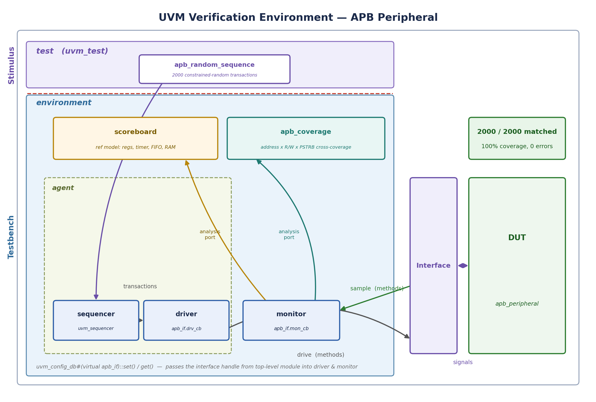
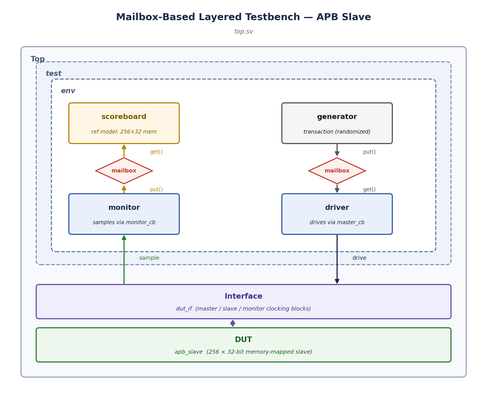
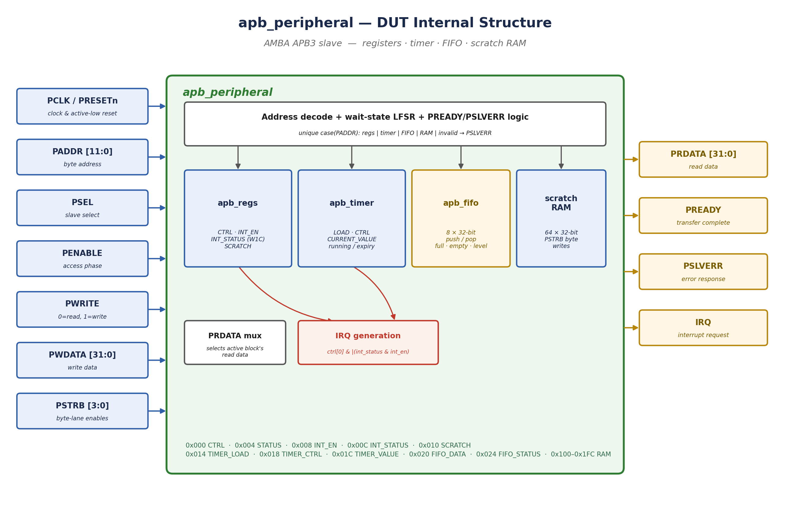

# AMBA APB Verification — Layered Testbench & UVM

Two SystemVerilog verification environments built around the AMBA APB protocol, at two different levels of DUT complexity: a mailbox-based layered testbench verifying a simple memory-mapped APB slave, and a full UVM environment — with functional coverage — verifying a multi-block APB peripheral (control/status registers, a timer, a hardware FIFO, scratch RAM, and APB error responses).

Verification performed using Cadence Xcelium (`xrun`).

> **Note:** the two testbenches target **different DUTs**, not the same design verified twice. The layered TB exercises a simple 256-word memory-mapped slave; the UVM TB exercises a considerably richer multi-block peripheral. See each section below for what's actually being checked.



## 1. Layered Testbench — `apb_slave`

A classic mailbox-connected environment (generator → driver → monitor → scoreboard) verifying a simple APB slave: a 256 x 32-bit memory-mapped RAM reachable over the standard APB `SETUP → ENABLE` two-phase transfer.



- **`transaction.sv`** — randomizable APB transaction (`paddr`, `pwrite`, `pwdata`), word-aligned and bounded to the slave's address range
- **`generator.sv`** — generates a configurable number of random transactions onto a mailbox
- **`driver.sv`** — drives transactions onto the `dut_if` virtual interface via the APB master clocking block
- **`monitor.sv`** — samples the bus every cycle via the passive clocking block and forwards observed transactions to the scoreboard
- **`scoreboard.sv`** — maintains a 256-word reference memory model and checks every read against it
- **`environment.sv`** — wires the above together and runs all phases concurrently

**Result (1024 transactions):** 371/371 checks passed, 0 mismatches.

### Running it

```bash
cd 01_layered_tb
xrun -access +rwc -f filelist.f
```

## 2. UVM Testbench — `apb_peripheral`

A full UVM environment verifying a considerably more complex APB peripheral with multiple internal blocks, constrained-random stimulus, a self-checking scoreboard, and functional coverage.



**DUT (`apb_peripheral`):**
- `apb_regs` — CTRL / INT_EN / INT_STATUS (write-1-to-clear) / SCRATCH registers
- `apb_timer` — programmable countdown timer with an expiry interrupt
- `apb_fifo` — an 8-deep, 32-bit hardware FIFO reachable over APB
- A 64 x 32-bit scratch RAM region with byte-granular writes via `PSTRB`
- An LFSR-driven wait-state generator inserting 0–3 extra `PREADY` cycles per transfer, and `PSLVERR` generation for undefined addresses, read-only register writes, unaligned RAM access, and illegal FIFO accesses

**Testbench (`02_uvm_tb`):**


- **`sequence_item.sv` / `sequence.sv`** — `apb_transaction` plus several sequences (smoke, register-bank, RAM, FIFO, timer/interrupt, error-injection, and a constrained-random stress sequence). The active test (`test.sv`) runs **`apb_random_sequence`**, generating **2000** fully-randomized transactions across the entire address map; the other sequences are kept in the codebase (commented into `test.sv`) as targeted, directed alternatives.
- **`driver.sv`** — drives the APB master side via `apb_if.drv_cb`
- **`monitor.sv`** — samples the bus via `apb_if.mon_cb` and publishes transactions over a `uvm_analysis_port`
- **`agent.sv`** — a standard active `uvm_agent` wrapping the sequencer + driver, with the monitor built alongside
- **`scoreboard.sv`** — a full reference model mirroring every register, the timer, the FIFO (as a queue), and the RAM, predicting both expected read data *and* expected `PSLVERR` on every transaction
- **`coverage.sv`** — a covergroup crossing address x read/write x `PSTRB`, plus dedicated bins for every register, RAM region, and the `PSLVERR` response
- **`environment.sv`** — fans the monitor's analysis port out to both the scoreboard and the coverage collector

**Result (2000 transactions, `apb_random_sequence`):**
- Scoreboard: **2000 / 2000 matched, 0 mismatches**
- Functional coverage: **100%** across every covergroup (address, read/write, `PSTRB`, `PSLVERR`, and both cross-coverage bins)
- **0** `UVM_ERROR` / `UVM_FATAL` reports

### Running it

```bash
cd 02_uvm_tb
xrun -access +rwc -uvm -f filelist.f
```

Adjust include/library flags as needed for your Xcelium install (e.g. `-incdir` if your UVM library path isn't on the default search path). The same sources should compile under other SystemVerilog/UVM simulators (Questa, VCS) with minor command-line differences.

## Repository Structure

```
.
├── 01_layered_tb/        # Layered TB verifying apb_slave (256x32 memory-mapped slave)
│   ├── apb.sv             # DUT
│   ├── dut_if.sv          # Interface with master/slave/monitor clocking blocks
│   ├── apb_pkg.sv
│   ├── transaction.sv
│   ├── generator.sv
│   ├── driver.sv
│   ├── monitor.sv
│   ├── scoreboard.sv
│   ├── environment.sv
│   ├── test.sv
│   ├── top.sv
│   └── filelist.f
├── 02_uvm_tb/             # UVM TB verifying apb_peripheral (regs + timer + FIFO + RAM)
│   ├── apb_regs.sv         # DUT sub-block
│   ├── apb_timer.sv        # DUT sub-block
│   ├── apb_fifo.sv         # DUT sub-block
│   ├── apb_peripheral.sv   # DUT top (address decode, wait-states, PSLVERR)
│   ├── apb_if.sv
│   ├── apb_pkg.sv
│   ├── sequence_item.sv
│   ├── sequence.sv          # smoke / reg / RAM / FIFO / timer / error / random sequences
│   ├── driver.sv
│   ├── monitor.sv
│   ├── agent.sv
│   ├── scoreboard.sv
│   ├── coverage.sv
│   ├── environment.sv
│   ├── test.sv
│   ├── top.sv
│   └── filelist.f
└── docs/
    └── images/
        ├── apb_layered_tb.png
        ├── apb_peripheral_dut.png
        └── apb_uvm_env.png
```

## Author

**Fahad Ahmad**
Digital IC Design & Verification
GIKI / Chip-DV

## License

MIT — see [LICENSE](LICENSE).
